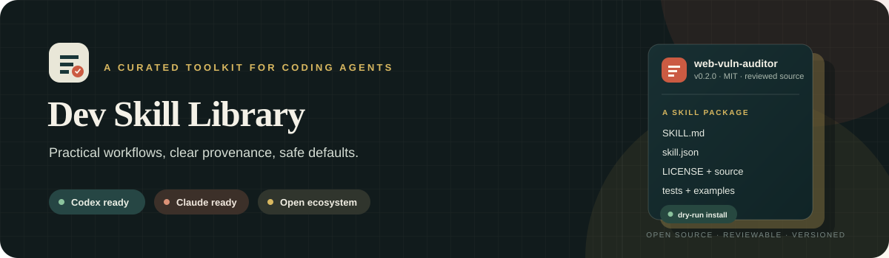

<div align="center">
  
  <br><br>
  
  <br>
  <a href="https://github.com/ashiqe-cell/dev-skill-library/actions/workflows/validate.yml"></a>
  <a href="LICENSE"></a>
  <a href="skills/"></a>
  <a href="CONTRIBUTING.md"></a>
</div>

<div align="center">
  <h3>Reusable workflows for Codex, Claude, and coding agents.</h3>
  <p>Small, useful packages with clear provenance, safe defaults, and tests you can run.</p>
  <p><a href="#catalog">Explore the catalog</a> · <a href="#quick-install">Install a skill</a> · <a href="CONTRIBUTING.md">Contribute</a></p>
</div>

---

## Why this library

Agent skills are easier to trust when you can see who made them, what they do, and how to install them. This project turns useful workflows into versioned packages, then checks the catalog and installer automatically.

| Each skill includes | The library provides |
|:--|:--|
| Clear scope and usage instructions | Provenance and license records |
| Version, maintainer, and source revision | Safe, preview-first installation |
| Tests or examples for its behavior | Automated checks on every change |

## Install across coding agents

Use the community skills CLI to install this package for Codex, Claude Code, Cursor, GitHub Copilot, and other supported agents:

```bash
npx skills add ashiqe-cell/dev-skill-library --skill web-vuln-auditor -g
```

Find the project on [skills.sh](https://skills.sh), or search from your terminal with `npx skills find web-vuln-auditor`. The directory is driven by the skills ecosystem, so real installs and continued maintenance help discovery. There is no separate publish button for the directory.

Prefer a manual, preview-first install? Use the library installer:

```bash
python scripts/install_skill.py --skill web-vuln-auditor --target codex
python scripts/install_skill.py --skill web-vuln-auditor --target codex --apply
```

The installer requires Python 3.10 or later and refuses to overwrite an existing installation. [See all options.](docs/INSTALLATION.md) For public marketplace publishing routes, see [distribution guide](docs/DISTRIBUTION.md).

## Catalog

<table>
  <thead>
    <tr><th align="left">Skill</th><th align="left">Use it for</th><th align="left">Version</th><th align="left">License</th></tr>
  </thead>
  <tbody>
    <tr>
      <td><a href="skills/web-vuln-auditor/"><strong>Web Vulnerability Auditor</strong></a></td>
      <td>Passive first-pass reviews of public websites for security, privacy, configuration, and SEO spam indicators</td>
      <td><code>0.2.0</code></td>
      <td><a href="skills/web-vuln-auditor/LICENSE">MIT</a></td>
    </tr>
  </tbody>
</table>

> Findings are indicators for human review. The auditor is not an exploit scanner, penetration test, or compliance certification.

### Add a skill you need

Tell us the recurring task and the developer workflow it should improve. [Open a skill request](https://github.com/ashiqe-cell/dev-skill-library/issues/new?template=skill_request.yml).

## Designed for trust

**Attribution is part of the package.** Company-authored, adapted, and third-party skills are labeled distinctly. Source revisions and license files travel with the code.

**Installation is deliberate.** The default is a dry run. The installer accepts an exact package name, blocks path traversal, and stops if a destination already exists.

**Quality is checked continuously.** GitHub Actions validates package metadata and runs the installer tests for every pull request and push to `main`.

Learn more in the [architecture](docs/ARCHITECTURE.md), [provenance policy](docs/PROVENANCE.md), and [release guide](docs/RELEASING.md).

## Contribute

Have a correction, a tested workflow, or a package worth sharing? Start with the [contribution guide](CONTRIBUTING.md), then open an issue or pull request. We review ownership, licensing, safety, and behavior before adding a package.

If this library is useful to you, a GitHub star helps other developers find it. Sharing a reproducible issue or a thoughtful contribution helps make it better.

## Project map

```text
skills/                 Curated agent skill packages
catalog/                Package index and names-only local inventory
scripts/                Validation and preview-first installer
tests/                  Catalog, install, and safety checks
docs/                   Architecture, provenance, install, and release guides
.github/workflows/      Continuous integration
```

The installed-skill files are a names-only snapshot from one machine. They are useful for discovery and do not claim ownership of those skills.

<div align="center">
  <sub>Built for useful workflows, transparent origins, and better agent tooling.</sub>
</div>
